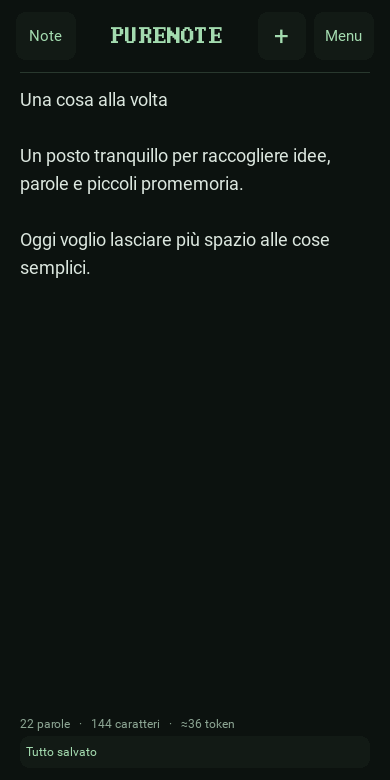
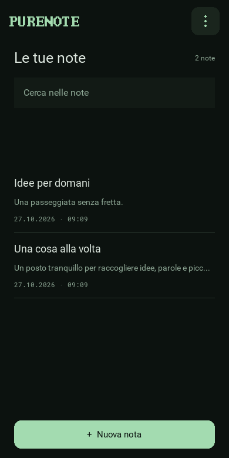

# PureNote

Un’app di note Android scritta in Python e Kivy. Rétro sobrio, un solo campo di
scrittura, nessun account. Le note restano in un database SQLite privato.

<p>
  
  
</p>

## Scrivere e ritrovare

- All’apertura ritrovi l’ultima nota. Una nuova installazione parte da un foglio vuoto.
- La prima riga non vuota dà il titolo alla nota; non c’è un campo titolo separato.
- Autosalvataggio dopo 300 ms senza modifiche e almeno ogni 2 secondi durante
  la digitazione continua. Cambio nota, background e chiusura normale forzano il salvataggio.
- Lista ordinata per ultima modifica, ricerca nel testo e condivisione Android.
- Cestino con ripristino, annullamento per 8 secondi e conferma prima di eliminare definitivamente.
- Backup JSON esportabile e ripristinabile tramite il selettore file di Android,
  senza permessi generali per accedere alla memoria.

Il backup automatico di sistema Android è disabilitato: l’esportazione manuale
permette di scegliere dove conservare una copia delle note.

Se un salvataggio fallisce, il testo resta nell’editor: l’app riprova e blocca
il cambio nota. Il menu permette di condividere il testo anche in questo caso.
L’arresto forzato del processo può perdere le modifiche ancora in attesa di salvataggio.
Un foglio nuovo lasciato vuoto non crea una nota; svuotare una nota esistente la conserva.

I contatori riguardano tutto il testo, inclusa la prima riga:

| Contatore | Convenzione |
| --- | --- |
| Parole | Sequenze separate da spazi o altro whitespace |
| Caratteri | Punti di codice Unicode, inclusi spazi e ritorni a capo |
| ≈ Token | `ceil(caratteri / 4)`, una stima; non usa un tokenizer specifico |

## Avvio e verifiche su desktop

Python 3.11 è la versione usata per sviluppo e CI.

```bash
python3.11 -m venv .venv
.venv/bin/python -m pip install -r requirements-dev.txt
.venv/bin/python main.py
.venv/bin/python -m pytest -q
.venv/bin/ruff check .
.venv/bin/python tests/ui_smoke.py
```

Su desktop la condivisione copia il testo negli appunti; backup e ripristino usano
un selettore file Kivy. Il database predefinito è `notes.db` accanto a `main.py`.
Per provare l’app senza toccare le note locali:

```bash
PURENOTE_DB=/tmp/purenote-demo.db .venv/bin/python main.py
```

La prova UI usa un database temporaneo, esercita il ciclo reale di Kivy e genera
anteprime in `/tmp/purenote-preview`. In CI gira con Xvfb. La simulazione degli
inset verifica il layout ridotto: non sostituisce una prova della tastiera Android.

## APK su GitHub

Il workflow **Build PureNote APK** esegue test della logica, lint e prova UI, poi
compila con Buildozer su Ubuntu. Parte su push, pull request oppure manualmente
in **Actions → Build PureNote APK → Run workflow**. Scarica `purenote-debug-apk`
negli artifact della run; sono disponibili anche log e anteprime dell’interfaccia.

La toolchain è fissata in `requirements-build.txt` e `buildozer.spec`:
Buildozer 1.6.0, Kivy 2.3.1, python-for-android v2026.05.09 (commit esatto),
SDK 36, NDK 28c e Android minimo 7.0 (API 24). La prima compilazione con questa
configurazione deve essere validata su GitHub; i test locali non dimostrano che
l’APK compili o funzioni su dispositivo.

`constraints-android.txt` mantiene lo stesso vincolo sulle dipendenze sia nel
risolutore Android sia nell’installazione dei moduli Python.

La cache riusa SDK, NDK, compilazioni parziali e chiave debug. Per una chiave debug
stabile anche dopo la scadenza della cache, puoi impostare il secret opzionale
`ANDROID_DEBUG_KEYSTORE_B64`. L’APK debug è per le prove: per aggiornare
un’installazione già presente occorre una firma compatibile, oppure usare
il backup prima di reinstallare.

L’AAB viene preparato dal workflow separato di release: vedi [RELEASE.md](RELEASE.md).
Il repository non viene pubblicato o inviato su GitHub dall’app.

## Codice e compatibilità dei dati

| Modulo | Responsabilità |
| --- | --- |
| `main.py`, `purenote_ui.kv`, `theme.py` | Navigazione, widget e stile |
| `editor.py` | Sessione, autosalvataggio e gestione degli errori |
| `db.py` | SQLite, migrazioni transazionali e ultima nota aperta |
| `backup.py`, `stats.py` | Formato portabile e statistiche offline |
| `documents.py`, `android_window.py` | Integrazione Android e tastiera |

Al primo avvio con il vecchio database, PureNote crea una copia SQLite
`notes.db.pre-v3.bak` prima della migrazione. Conserva testo, date, cestino, tag e
stato delle vecchie note fissate; tag e pin non compaiono più nell’interfaccia.
I vecchi titoli separati vengono inseriti nel testo solo se non sono già presenti
nella prima riga. Il Markdown resta testo normale.

Il backup ha questo contenitore, con record delle note comprensivi di
`title`, `body`, `tags`, `pinned`, `created_at`, `updated_at`, `trashed`:

```json
{"app": "PureNote", "version": 1, "notes": []}
```

Gli ID locali non vengono esportati. Il file è UTF-8, con limite di 32 MiB.
L’importazione valida tutte le note prima di scrivere, aggiunge copie con nuovi ID
e conserva le note esistenti. Ripristinare due volte lo stesso file crea duplicati.
I vecchi backup `.db` rimangono copie di sicurezza SQLite e non sono accettati dal
nuovo importatore JSON.
